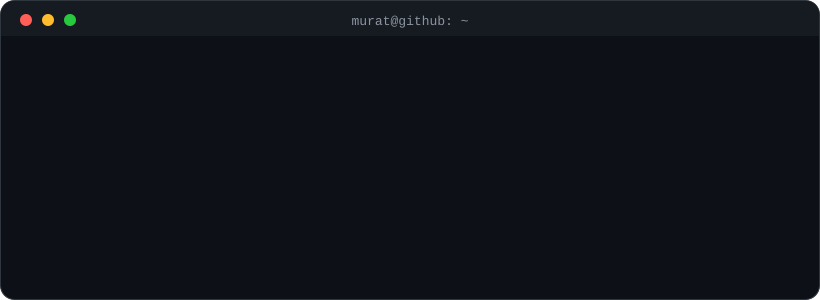

<h2>Murat Can Nergiz</h2>
<b>Computer Engineering Student · Backend &amp; AI Developer</b>

 

  

<table>
  <tr>
    <td width="50%" valign="top">
      <h3>🤖 <a href="https://github.com/codcreater1/agentic-internship-coordinator">Agentic Internship Coordinator</a></h3>
      
AI-powered CV screening and internship coordination with automated workflows.

      
      
      
      
    </td>
    <td width="50%" valign="top">
      <h3>🛡️ <a href="https://github.com/codcreater1/ai-code-analyzer">AI Code Analyzer</a></h3>
      
Multi-language static analyzer with SAST, OWASP &amp; CWE checks and AI-powered fix suggestions.

      
      
    </td>
  </tr>
  <tr>
    <td width="50%" valign="top">
      <h3>📚 <a href="https://github.com/codcreater1/ata-rag">ATA RAG</a></h3>
      
RAG pipeline with vector search and LLM observability.

       
      
      
      
    </td>
    <td width="50%" valign="top">
      <h3>🧠 <a href="https://github.com/codcreater1/agent-assignment">Task Execution AI Agent</a></h3>
      
Plans subtasks, asks clarifying questions, calls tools and recovers from errors.

      
      
    </td>
  </tr>
  <tr>
    <td width="50%" valign="top">
      <h3>🚨 <a href="https://github.com/codcreater1/OpsPulse-AI-Autonomous-Incident-Response-RCA-Agent">OpsPulse AI</a></h3>
      
Incident investigation &amp; root-cause analysis agent with a deterministic quality gate and human-approved GitHub remediation.

       
      
      
      
    </td>
    <td width="50%" valign="top">
      <h3>🎓 <a href="https://github.com/codcreater1/Internship-report-reviewer">Internship Report Reviewer</a></h3>
      
Checks internship PDFs, tells students what to fix, and issues a signed certificate only on coordinator approval.

      
      
      
      
    </td>
  </tr>
  <tr>
    <td width="50%" valign="top">
      <h3>📏 <a href="https://github.com/codcreater1/AI-Evaluation">AI Evaluation Platform</a></h3>
      
Reusable evaluation infrastructure for AI apps, built on Langfuse and wired to real deployed systems.

      
      
    </td>
    <td width="50%" valign="top">
      <h3>⌨️ <a href="https://github.com/codcreater1/Termainal-Todo-App">Terminal Todo App</a></h3>
      
Fast, minimal task manager that lives in the terminal.

      
    </td>
  </tr>
</table>

<h3>⚡ Recent Activity</h3>

<!--ACTIVITY:START-->
<!--ACTIVITY:END-->

  
⭐ If you like something here, drop a star — it keeps the coffee flowing ☕

<!-- last-active: 2026-07-31 -->
